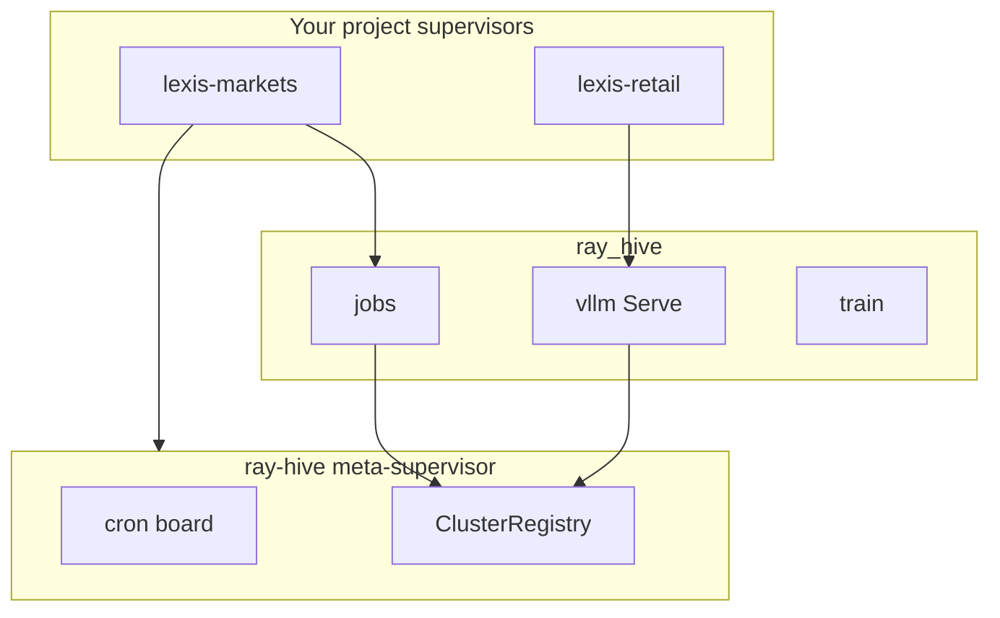
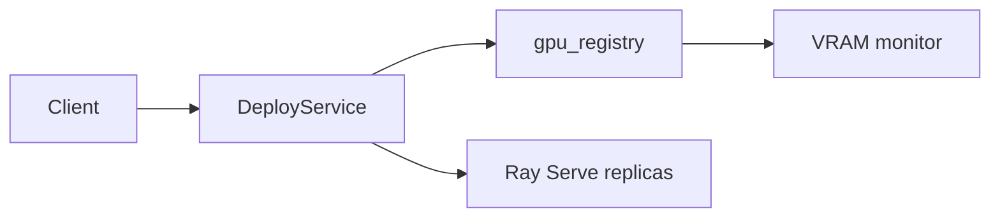

# ray-hive

Shared-cluster toolkit for Ray: **job primitives** (IO/CPU fan-out, gates, durable queues, cron board), optional **vLLM Serve**, optional **Train** for custom PyTorch/HF. One install, extras for heavy deps.

```text
pip install "ray-hive[jobs]"          # core (already in base)
pip install "ray-hive[vllm]"          # Serve + vLLM path
pip install "ray-hive[train]"         # Ray Train / custom infer
pip install "ray-hive[all]"           # vllm + train
```



On connect you get one stdout line: `ray-hive <ver> — https://github.com/BasicOverflow/ray-hive`.

---

## Jobs primitives

### ProjectContext + ClusterRegistry

Claim Serve routes, model ids, cron ids so projects do not collide on a shared cluster.

```python
from ray_hive.cluster import ProjectContext, init_ray_for_project

ctx = ProjectContext(
    project_id="lexis-markets",
    namespace="lexis-markets",
    serve_route_prefix="/markets",
)
init_ray_for_project("ray://10.0.1.52:10001", ctx)
```

Gotcha: claims live in namespace `ray_hive_system`. Miss heartbeats long enough and the meta-supervisor GC releases them.

### Envelopes (`io_remote` / `cpu_remote` / `ops_remote`)

```python
from ray_hive.jobs import io_remote, cpu_remote

@io_remote()
def fetch_chunk(urls: list[str]) -> list:
    ...

@cpu_remote(num_cpus=-1)  # -1 → AdmissionBroker suggests
def stitch(batch: list) -> list:
    ...
```

Workload envelopes always set `label_selector` so tasks stay off the head and off vram-monitor pods. There is no opt-out. Use `ops_remote` for head-pinned ops (Serve restart, disk prune).

### BatchFanout + AdmissionBroker

```python
from ray_hive.jobs import BatchFanout, TaskShape

fan = BatchFanout()
shape = TaskShape(batch_size=32, max_ceiling=64, cpus_per_task=0.001)
fan.run("ingest", items, lambda batch: fetch_chunk.remote(batch), shape)
```

In-flight width comes from live Ray CPU/RAM headroom, not a fixed `MAX_TASKS`. `max_ceiling` / `max_in_flight` are safety rails.

### RateGate

```python
from ray_hive.jobs import get_or_create_rate_gate
import ray

gate = get_or_create_rate_gate("yf-gate", namespace="lexis-markets", min_interval=2.5)
ray.get(gate.acquire.remote())
# call external API
ray.get(gate.record_success.remote())
```

### DurableJobQueue

```python
from ray_hive.jobs import DurableJobQueue

q = DurableJobQueue("/var/lib/myapp/queue.db")
q.enqueue("eod", {"day": "2024-06-01"})
job = q.claim_next(["eod"])
# ... work ...
q.complete(job["id"])
```

Works while Ray is down. Stale `running` rows requeue after `stale_running_s`.

### CronSchedule + cron board

```python
from ray_hive.jobs import CronSchedule, get_cron_board
import ray

CronSchedule("markets-eod", "lexis-markets", "16:05", load_class="io")
board = get_cron_board()
print(ray.get(board.list_entries.remote()))  # next_fire / load_class for all projects
```

Project supervisors still fire the work; the meta board is the cluster utilization calendar.

### JobProgress

```python
from ray_hive.jobs import JobProgress

prog = JobProgress("/var/lib/myapp/progress.db", "embed-v1")
todo = prog.pending(all_ids)
for i in todo:
    ...
    prog.mark_done(i)
```

### ScratchShardStore / ServeAppHeal / NodeBroadcast / MapShuffleReduce

See `ray_hive/jobs/` — local scratch generations, Serve deploy cool-down with route claim, one ops task per node, map→shuffle→reduce helper. Request coalescing (identical in-flight HTTP→remote) stays in your app, not in hive.

---

## Meta-supervisor

LXC/systemd entry: `python -m ray_hive.supervisor.main`.

Keeps ClusterRegistry + AdmissionBroker + cron board warm, GC’s dead projects, redeploys sticky **vLLM** models when claimed. It does **not** replace Markets/Retail supervisors — those register into it and own domain queues.

State file: `HIVE_SUPERVISOR_STATE` (SQLite): sticky models, projects, cron_board mirror, queues, trains, claims.

---

## vLLM Serve (optional `[vllm]`)

Same client as before:

```python
from ray_hive import RayHive

hive = RayHive("ray://10.0.1.52:10001")
hive.deploy_model(
    model_id="demo",
    model_name="Qwen/Qwen3-0.6B",
    max_input_prompt_length=2048,
    max_output_prompt_length=256,
    replicas=1,
    vllm_kwargs={},
)
```

Details: [Placement](#placement), [Allocation policies](#allocation-policies), [Lifecycle](#lifecycle), [OpenAI HTTP](#openai-http), examples under `examples/`.



---

## Train / custom infer (optional `[train]`)

Sibling to vLLM — your `nn.Module` / HF code, VRAM claims via the same registry.

```python
from ray_hive.train import TrainJob, gpu_remote

@gpu_remote()
def worker_step(batch):
    ...

job = TrainJob("run-1", "athena", train_fn=my_loop, num_workers=2)
job.run()
```

`CustomInferService` claims a `model_id` then calls your deploy/shutdown callables.

---

## Placement

Throughput-first planning, heterogeneous replicas, least-loaded routing, live VRAM scheduling, GPU sharing, TP, sleep/idle — see `examples/1_test_model_configs.py`, `4_test_allocation_policies.py`, `5_tensor_parallel.py`, `7_sleep_idle_timeout.py`.

## Allocation policies

`PerformanceAllocator` / `ConserveTdpAllocator` in `ray_hive.core.gpu_alloc.policies`. Pass `allocation_cls=` to `deploy_model`.

## Custom attention / multimodal / embeddings

Subclass attention specs (`examples/3_custom_attention.py`). MM generate and pooling runners: `examples/8`–`14`, `10`–`11`.

## Lifecycle

Hive-scoped shutdown (does not `serve.shutdown()` the whole cluster). Sticky pin when `HIVE_SUPERVISOR_STATE` is set. GCS FT Redis: `manifests/ray-gcs-redis.yaml`.

## OpenAI HTTP

Per-model routes + `/v1` gateway — `examples/2_test_inference.py`.

## Ops

- Meta-supervisor CT: `deploy/` on home-media  
- Worker image: `manifests/Dockerfile.ray-vllm-worker`  
- Internals (admission, GC, chaos): Homelab `projects/ray-hive/`
